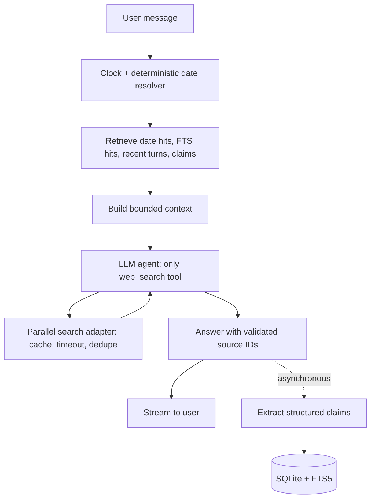

# Design: Minimi, a research agent with temporal memory

## How it works

The sample prompts are not ordinary search questions: they require temporal resolution, recall
of an earlier baseline, and fresh verification. The application resolves dates and retrieves
memory before the model runs. The model has exactly one tool, `web_search`; memory is injected
as bounded context rather than exposed as another tool.

## Why this design

- **SQLite + FTS5:** durable, zero-service setup, date indexes and lexical retrieval. No vector
  database until evaluation demonstrates a need.
- **Code-based date math:** predictable weekday and calendar resolution; the prompt receives
  absolute windows and the answer should echo the assumption.
- **Claims ledger:** makes historical comparisons explicit and cheap. It stores the claim,
  entity, type, value, date, source URLs and extraction confidence. Raw message retrieval remains
  the fallback when background extraction has not completed.
- **Parallel search:** independent entities are checked concurrently; bounded rounds, result
  count and request timeout control cost and tail latency.
- **SSE:** status and answer events keep the UI responsive without requiring a heavier framework.

## Considered and rejected

A memory tool was rejected because it would violate the one-tool brief and add a model round trip.
A vector database was rejected as unnecessary operational complexity for a small local corpus.
A multi-agent planner was rejected because parallel function calls cover the core workload with
less latency and less orchestration. Browser automation/fetching was rejected because the task
grants one tool: web search. LLM date arithmetic was rejected in favour of deterministic code.

## Trade-offs and known weaknesses

The initial temporal resolver deliberately covers common expressions, not every language pattern.
FTS5 can miss semantic paraphrases. Search-provider date metadata can be incomplete; a query-level
date constraint is not a guarantee that every result is recent. Claim extraction is probabilistic,
so ledger entries remain historical evidence, not ground truth. A "no change" verdict requires
checking a current authoritative source; empty search results must remain "could not verify".

## With another week

1. Add a larger seeded eval corpus for all three sample prompts, memory misses, prompt injection,
   stale sources and ambiguous dates.
2. Add a server-side citation validator and source-quality scoring.
3. Add deterministic structured diffs for numeric prices, limits and versions.
4. Improve retrieval with entity normalization and embeddings only if FTS recall is inadequate.
5. Stream per-entity progress/results and expose the exact checked date/source.
6. Add user correction of extracted claims and migration/versioning for the ledger schema.

## Measurement plan

Track time to first status, time to first token, total latency, search count, cache hit rate,
tokens, and factual/citation checks per eval case. Compare serial vs parallel search and ledger
enabled vs raw-history-only retrieval before making performance claims.
