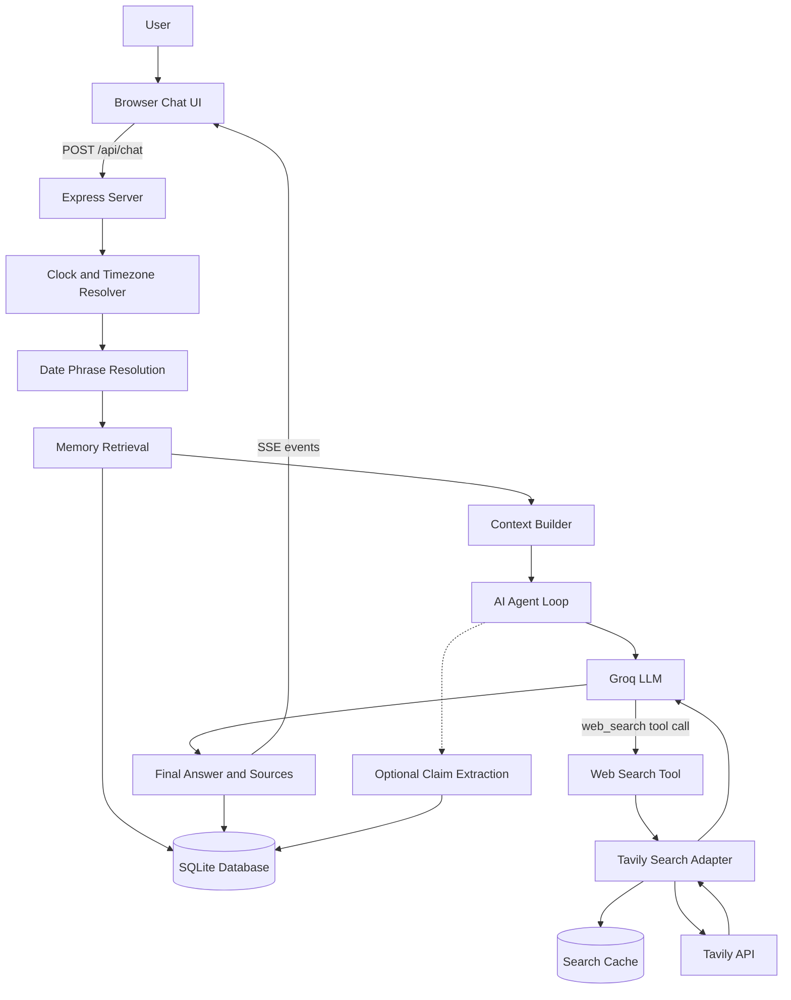
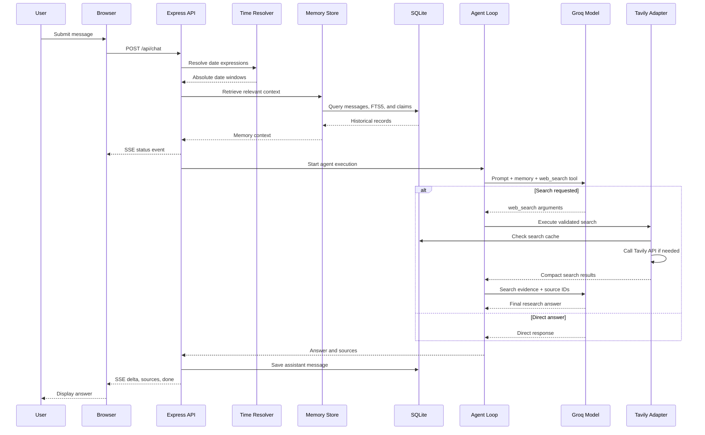
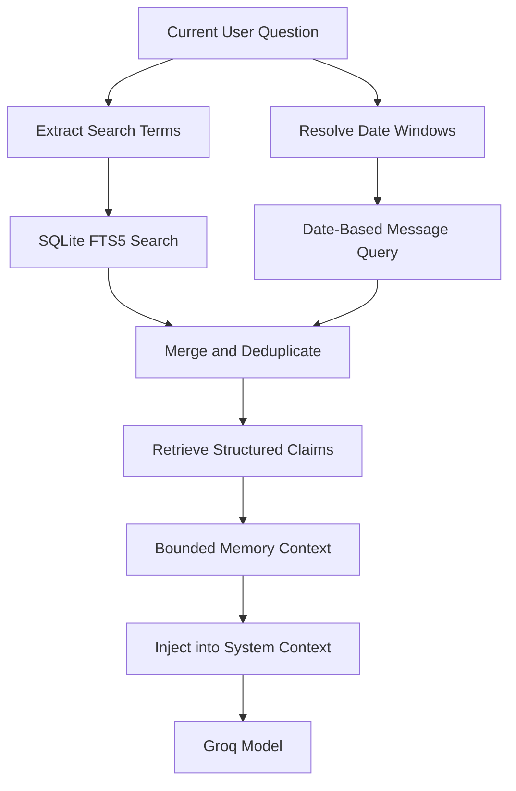
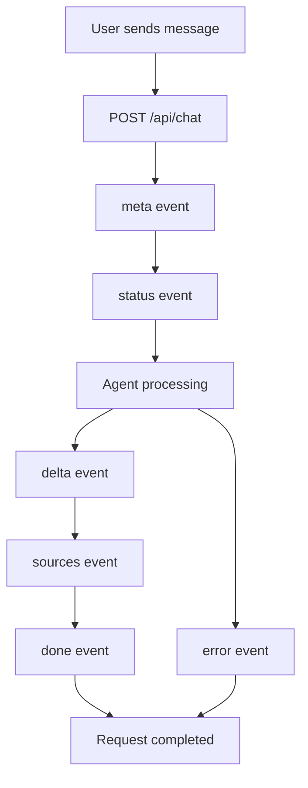
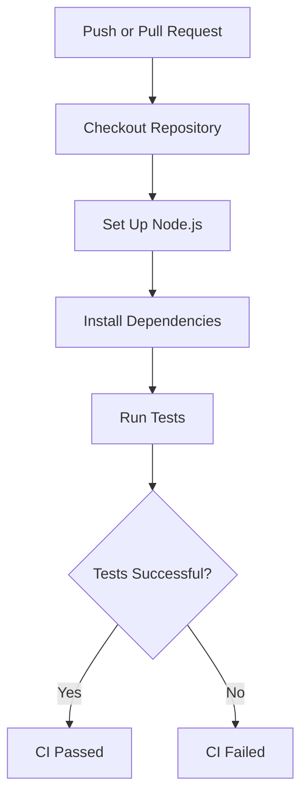

# Minimi — An AI Chat Agent That Remembers and Re-Verifies

<p align="center">
  <strong>A persistent research assistant that remembers conversations, searches the web, and helps verify whether information is still accurate.</strong>
</p>

<p align="center">
  
  
  
  
  
  
</p>

---

## 1. Overview

Minimi is a single-user AI research chat agent designed around two important capabilities:

- **Persistent conversational memory:** It can retrieve relevant information from previous conversations instead of treating every message as an isolated interaction.
- **Information re-verification:** It can search the public web to investigate current information and compare it with previously discussed claims.

Unlike a basic chatbot, Minimi combines conversational history, date-aware retrieval, structured claims, and web search to provide context-aware responses.

The application is built with JavaScript and Node.js, using an Express backend, SQLite for persistence, Groq for model inference, and Tavily for web search.

### Core design principle

Minimi exposes exactly one model-visible tool:

`web_search`

Memory retrieval, date resolution, database access, and context construction happen inside the application rather than being exposed as additional model tools.

This keeps the agent's tool interface small and makes its execution flow easier to control.

---

## 2. Key Features

| Feature | Implementation |
|---|---|
| Conversational AI | Groq API using an OpenAI-compatible client |
| Persistent conversations | SQLite |
| Conversation history | Stored messages with conversation IDs |
| Long-term memory retrieval | SQLite queries and FTS5 |
| Structured claim storage | Claims ledger |
| Web research | Tavily Search API |
| Model-visible tools | Exactly one: `web_search` |
| Date awareness | Server clock and timezone resolver |
| Real-time chat updates | Server-Sent Events (SSE) |
| Source references | Search source IDs such as `[S1]` |
| Conversation management | Create, open, and delete conversations |
| Request cancellation | AbortController and request signals |
| Search caching | SQLite-backed search cache |
| Responsive interface | HTML, CSS, and JavaScript |

---

## 3. Technology Stack

### Backend

- **Node.js:** JavaScript runtime.
- **Express.js:** HTTP server and API routes.
- **OpenAI SDK:** OpenAI-compatible client used to communicate with Groq.
- **Zod:** Validation of model-generated web search arguments.
- **SQLite:** Persistent application storage.
- **FTS5:** Full-text search for relevant conversation messages.

### AI and research

- **Groq:** Language model inference.
- **Tavily:** Public web search API.
- **Agent loop:** Controls model requests, tool execution, search limits, and final responses.

### Frontend

- HTML5
- CSS3
- Vanilla JavaScript
- Fetch API
- Server-Sent Events
- AbortController

### Development and quality

- npm
- Git and GitHub
- GitHub Actions
- Node.js test runner / project test scripts

---

## 4. Project Architecture

Minimi follows a modular architecture that separates the frontend, HTTP server, agent execution, search integration, memory retrieval, and persistence.

### High-level architecture



### Architecture responsibilities

| Component | Responsibility |
|---|---|
| Browser UI | Chat interface, conversation navigation, and source display |
| Express server | API routes, request lifecycle, persistence, and SSE |
| Time resolver | Resolves relative date expressions |
| Memory module | Retrieves relevant historical context |
| Context builder | Combines prompt, memory, and recent history |
| Agent loop | Coordinates model inference and tool execution |
| Groq | Generates responses and requests web searches |
| Search adapter | Validates, executes, and caches web searches |
| Tavily | Supplies public web search results |
| SQLite | Stores conversations, messages, claims, and search cache |

---

## 5. Folder Structure

The following is the intended organization of the JavaScript project. It includes the main files and supporting directories used by the implementation.

```text
minimi-agent/
│
├── public/
│   ├── index.html
│   ├── app.js
│   └── style.css
│
├── src/
│   │
│   ├── agent/
│   │   ├── loop.js
│   │   └── prompt.js
│   │
│   ├── search/
│   │   └── tavily.js
│   │
│   ├── memory/
│   │   ├── db.js
│   │   ├── store.js
│   │   └── ledger.js
│   │
│   ├── server.js
│   ├── config.js
│   └── time.js
│
├── tests/
│   └── ...
│
├── evals/
│   └── ...
│
├── docs/
│   └── architecture.md
│
├── .github/
│   └── workflows/
│       └── ...
│
├── .env
├── .env.example
├── .gitignore
├── COMMIT_PLAN.md
├── DESIGN.md
├── LICENSE
├── package.json
├── package-lock.json
└── README.md
```

### Important directories

**`public/` — Frontend**

Contains the browser interface.

- `index.html`: Main chat application structure.
- `app.js`: Message handling, conversation navigation, SSE processing, and cancellation.
- `style.css`: Responsive interface styling and sidebar layout.

**`src/agent/` — Agent execution**

- `loop.js`: Implements the model and tool-calling loop.
- `prompt.js`: Defines the system instructions and contextual behavior.

**`src/search/` — Search integration**

- `tavily.js`: Calls the Tavily API, handles search caching, and normalizes search results.

**`src/memory/` — Persistent memory**

- `db.js`: Initializes the SQLite database and related structures.
- `store.js`: Stores conversations and messages and retrieves relevant memory.
- `ledger.js`: Handles structured claim extraction.

**`tests/` — Automated tests**

Contains test cases for application components.

**`evals/` — Evaluation scenarios**

Contains evaluation cases used to assess the agent's behavior.

---

## 6. Agent Execution Flow

A typical request follows this sequence:

1. The user submits a message through the browser.
2. The frontend sends the message, conversation ID, and timezone to the Express API.
3. The server obtains the current time.
4. Relative date expressions are resolved into absolute date windows.
5. Relevant conversation history and memory are retrieved from SQLite.
6. The system prompt, memory, recent history, and user message are assembled.
7. The agent sends a request to Groq.
8. The model either generates a direct answer or requests the `web_search` tool.
9. The application validates the search arguments and calls Tavily.
10. Search results are compacted and returned to the model.
11. A final model request summarizes the available evidence.
12. The answer and source references are returned to the browser.
13. The assistant response is persisted in SQLite.

### Sequence diagram



---

## 7. Persistent Memory Implementation

Memory is one of Minimi's central design decisions.

Instead of requiring the model to call a memory tool, the backend retrieves relevant information before the model request.

This keeps memory access separate from the model-visible tool interface.

### Memory sources

Minimi uses several sources of context:

**1. Recent conversation history**

Recent messages from the active conversation are retrieved and supplied to the agent.

**2. Date-based retrieval**

The application resolves date expressions and queries messages within the resulting time windows.

**3. Full-text search**

SQLite FTS5 is used to retrieve messages that match relevant words from the current question.

**4. Structured claims**

The claims ledger stores extracted information such as:

- Topic
- Entity
- Claim text
- Claim type
- Value
- Date of observation
- Source URLs
- Confidence

### Memory retrieval diagram



### Why SQLite and FTS5?

SQLite keeps the application lightweight and avoids the need for a separate database server.

FTS5 provides lexical full-text retrieval without requiring a vector database.

A vector database may become useful if future evaluation demonstrates that lexical retrieval is insufficient.

---

## 8. Web Search and Research

Minimi uses Tavily as its web search provider.

The model can request web research through exactly one tool:

`web_search`

### Search execution

1. The model generates search arguments.
2. Zod validates the arguments.
3. The agent calls the Tavily adapter.
4. The adapter checks the SQLite search cache.
5. If no valid cached result exists, it sends a request to Tavily.
6. Results are normalized and compacted.
7. The results are returned to the model.
8. The model generates an answer with source references.

### Search result structure

A normalized result contains fields such as:

```json
{
  "id": "S1",
  "title": "Example source title",
  "url": "https://example.com/article",
  "published_date": "2026-01-01",
  "snippet": "A short summary of the source."
}
```

The actual fields passed to the model are compacted to reduce token usage.

### Source references

The model is instructed to cite the supplied source identifiers, for example:

- `[S1]`
- `[S2]`
- `[S3]`

The frontend displays the corresponding source links.

The application should not treat a search result as proof of a claim by itself. Source quality, publication date, and relevance still matter.

### Current execution limits

The current low-cost configuration is intentionally bounded:

| Setting | Current value |
|---|---:|
| Agent rounds | 1 |
| Web searches per request | 1 |
| Search results passed to model | 3 |
| Recent history messages | 3 |
| Maximum completion tokens | 512 |
| Search result content excerpt | 350 characters |
| Model request timeout | 20 seconds |

These limits help control token consumption and provider rate limits.

The agent can make up to two model requests when a search is required: one for tool selection and one for summarizing the returned evidence.

---

## 9. Date and Time Awareness

Minimi resolves temporal expressions in application code rather than asking the language model to calculate dates.

Examples include:

- Today
- Yesterday
- Specific weekdays
- Day and month expressions

The server clock and the user's timezone are used to resolve date windows.

This reduces ambiguity when a user asks questions such as:

- What did we discuss yesterday?
- What changed this week?
- What was the information I shared last Monday?

The date resolver currently supports common date expressions rather than every possible natural-language time expression.

---

## 10. Real-Time Communication with SSE

Minimi uses Server-Sent Events to communicate progress and results from the backend to the browser.

The frontend receives named events.

| Event | Purpose |
|---|---|
| `meta` | Provides conversation ID and time metadata |
| `status` | Displays current processing activity |
| `delta` | Sends the answer text |
| `sources` | Provides research sources |
| `done` | Signals request completion |
| `error` | Reports request failures |
| `ping` | Keeps the connection alive |

### SSE request flow



The current backend sends the completed answer through a `delta` event. This provides an SSE-based response lifecycle, but it is not token-by-token model streaming.

---

## 11. Conversation Management

Minimi supports persistent conversations.

### Available functionality

- Start a new conversation.
- Open an existing conversation.
- Retrieve saved message history.
- Display recent conversations in the sidebar.
- Delete a conversation.
- Stop an active generation request.

### Conversation deletion

Deleting a conversation removes its associated messages and structured claims through the storage layer.

The deletion operation is intended to run transactionally so related records are not left partially deleted.

### Relevant API endpoints

| Method | Endpoint | Purpose |
|---|---|---|
| GET | `/api/conversations` | List recent conversations |
| GET | `/api/history/:id` | Load conversation messages |
| POST | `/api/chat` | Send a chat message |
| DELETE | `/api/conversations/:id` | Delete a conversation |

---

## 12. API and Configuration

Minimi uses environment variables for provider credentials and runtime settings.

Create a `.env` file in the project root.

### Example `.env`

```env
OPENAI_API_KEY=your_groq_api_key
OPENAI_BASE_URL=https://api.groq.com/openai/v1
OPENAI_MODEL=openai/gpt-oss-120b

TAVILY_API_KEY=your_tavily_api_key

ENABLE_CLAIM_EXTRACTION=false
```

The OpenAI SDK is used with Groq's OpenAI-compatible API endpoint.

### Environment variable reference

| Variable | Purpose |
|---|---|
| `OPENAI_API_KEY` | Groq API key used by the OpenAI-compatible client |
| `OPENAI_BASE_URL` | Model provider API base URL |
| `OPENAI_MODEL` | Model identifier |
| `TAVILY_API_KEY` | Tavily search API key |
| `ENABLE_CLAIM_EXTRACTION` | Enables optional background claim extraction |
| `PORT` | HTTP server port, if supported by configuration |
| `DEFAULT_TZ` | Default timezone, if supported by configuration |
| `DB_PATH` | SQLite database location, if supported by configuration |
| `NOW_OVERRIDE` | Deterministic clock override, if supported by configuration |

Only variables read by the application configuration should be considered active. Check `src/config.js` before changing defaults.

### Security

- Never commit `.env` to GitHub.
- Keep API keys private.
- Use `.env.example` for documentation.
- Do not expose provider credentials in frontend JavaScript.
- Validate tool arguments before calling external APIs.
- Limit request sizes and execution time.

---

## 13. Installation and Local Setup

### Requirements

- Node.js 20.10 or newer.
- npm.
- A Groq API key.
- A Tavily API key.

### Step 1 — Clone the repository

```bash
git clone https://github.com/Prince-Koladiya09/minimi_agent.git
cd minimi_agent
```

### Step 2 — Install dependencies

```bash
npm install
```

### Step 3 — Configure environment variables

Copy the example environment file.

**Windows PowerShell:**

```powershell
Copy-Item .env.example .env
```

**macOS / Linux:**

```bash
cp .env.example .env
```

Add your actual Groq and Tavily API keys to `.env`.

### Step 4 — Start the development server

```bash
npm run dev
```

### Step 5 — Open Minimi

Visit:

[http://localhost:3000](http://localhost:3000)

---

## 14. Testing and Evaluation

Testing is important because memory retrieval and information re-verification can produce misleading answers if historical context or source evidence is handled incorrectly.

Run the project's configured tests:

```bash
npm test
```

Run the evaluation suite:

```bash
npm run eval
```

The actual scripts are defined in `package.json`.

### Recommended evaluation scenarios

| Test area | Example scenario |
|---|---|
| Memory retrieval | Ask about a detail from a previous conversation |
| Date retrieval | Ask what was discussed yesterday |
| Search behavior | Ask for current information that requires web research |
| Search validation | Supply invalid search arguments |
| Citation behavior | Verify that source IDs correspond to returned results |
| Conversation persistence | Restart the server and load an existing conversation |
| Cancellation | Stop a request while it is processing |
| Error handling | Test provider failures and rate limits |
| Deletion | Delete a conversation and verify its messages are removed |
| Token limits | Test longer questions and search responses |

### Suggested future evaluations

- Retrieval precision and recall.
- Historical claim accuracy.
- Temporal reasoning accuracy.
- Citation correctness.
- Search relevance.
- Response latency.
- Token consumption.
- Resistance to unsupported claims.

Evaluation results should be recorded before changing models or search providers.

---

## 15. Error Handling and Reliability

Minimi includes safeguards to make agent execution more predictable.

### Provider error handling

The agent handles common provider errors, including:

- HTTP 401 — Invalid API key.
- HTTP 404 — Model not found.
- HTTP 429 — Rate limit exceeded.
- Timeout — Provider response took too long.

### Request cancellation

The browser uses `AbortController` to cancel an active request.

The backend uses an `AbortController` to propagate cancellation to the agent and supported search requests.

### Search limits

Search result count, history length, model completion size, and request timeouts are bounded.

These controls help reduce unnecessary API usage and make failures easier to diagnose.

---

## 16. GitHub Actions and Continuous Integration

The repository includes a GitHub Actions workflow for automated quality checks.

The intended CI process is:



CI is intended to run installation and tests on pushes and pull requests.

The workflow does not deploy the application because no hosting target or deployment credentials are configured.

---

## 17. Design Decisions and Trade-offs

### 1. Memory is retrieved before the model call

Memory is injected into the prompt by the application rather than exposed as another model tool.

This preserves the single-tool design and avoids an extra model round trip for memory lookup.

### 2. SQLite instead of a separate database server

SQLite keeps the project simple to run locally and supports persistent storage and FTS5 search.

### 3. Deterministic date resolution

Date arithmetic is handled in code to reduce incorrect date calculations by the language model.

### 4. Bounded agent execution

The agent uses limited search and token budgets to reduce API usage and improve predictability.

### 5. Optional background claim extraction

Claim extraction can be disabled to conserve API tokens.

It is not required for the basic conversation and memory retrieval flow.

### 6. Source IDs for citations

The agent receives source identifiers and is instructed to reference them rather than inventing URLs.

---

## 18. Known Limitations

Minimi is a focused single-user challenge implementation, not a fully hardened multi-tenant production service.

Current limitations include:

- Temporal matching supports common date expressions rather than every natural-language expression.
- Tavily is the sole configured web search backend.
- Search and model execution limits are intentionally conservative.
- The current agent performs only one search round and one search operation per request.
- The final answer is delivered through SSE after model generation rather than true token-by-token streaming.
- Structured claim extraction is best-effort and should be evaluated before its output is treated as verified.
- FTS5 provides lexical retrieval and may miss semantically related messages.
- A zero-result search does not establish that a previously discussed claim is false or unchanged.
- The application is designed for a single user and does not yet provide a complete multi-user authentication system.

---

## 19. Future Improvements

Potential improvements include:

- More robust temporal expression parsing.
- Better memory ranking and retrieval evaluation.
- Semantic memory retrieval if evaluation justifies it.
- Multiple independent searches with controlled parallel execution.
- True token streaming from the model.
- Improved source quality assessment.
- Claim contradiction and change detection.
- More comprehensive automated tests.
- Better observability and execution tracing.
- Authentication and multi-user support.
- Production deployment and monitoring.

---

## 20. Project Goals

Minimi explores how an AI chat agent can move beyond isolated question answering.

Its central goals are:

1. Remember useful information from earlier conversations.
2. Retrieve relevant historical context at the right time.
3. Understand date-sensitive questions.
4. Search for current information when necessary.
5. Distinguish historical information from newly retrieved evidence.
6. Communicate uncertainty instead of inventing changes or facts.
7. Provide a simple, persistent chat experience.

The goal is not simply to build another chatbot, but to build an assistant that can maintain context and revisit information when circumstances change.

---

## 21. Author and Repository

**Project:** Minimi — Persistent Memory Research Chat Agent

**GitHub:** [Prince-Koladiya09/minimi_agent](https://github.com/Prince-Koladiya09/minimi_agent)

Built as a focused AI agent engineering project using JavaScript, Node.js, Groq, Tavily, and SQLite.

---

<p align="center">
  <strong>Minimi — Remember context. Re-check facts. Answer with evidence.</strong>
</p>