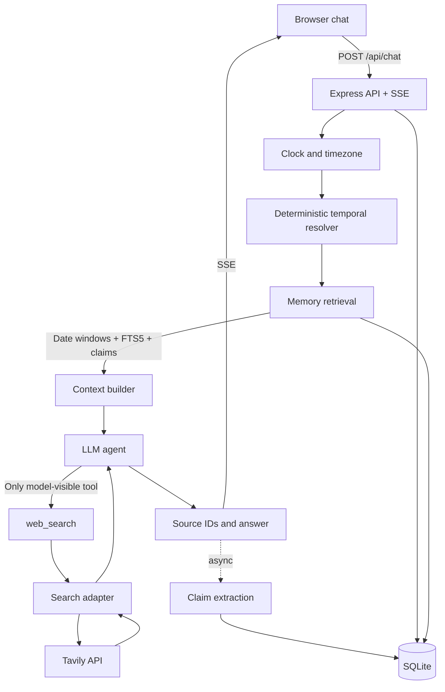
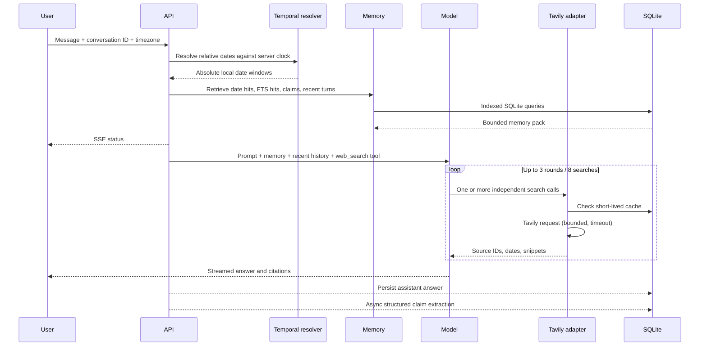

# Minimi — a chat agent that remembers and re-verifies

Minimi is a single-user research chat agent with exactly one model-visible tool: `web_search`.
It is designed around the hard part of the challenge: answering questions that refer to past
conversations and determining whether old claims remain true.

## Quick start

Requirements: Node.js 20.10+ and API keys for OpenAI and Tavily.

```bash
cp .env.example .env
# Add OPENAI_API_KEY and TAVILY_API_KEY
npm install
npm run dev
```

Open [http://localhost:3000](http://localhost:3000).

## Environment

| Variable | Required | Purpose |
|---|---:|---|
| `OPENAI_API_KEY` | yes | Chat completion + background claim extraction |
| `OPENAI_MODEL` | no | Defaults to `gpt-4.1-mini` |
| `TAVILY_API_KEY` | yes | Web search |
| `PORT` | no | Defaults to `3000` |
| `DEFAULT_TZ` | no | Defaults to `Asia/Kolkata` |
| `NOW_OVERRIDE` | no | Deterministic clock for temporal tests |
| `DB_PATH` | no | SQLite file location |

## Architecture



## Request flow



## Design choices

- **Memory is retrieved before the model call, not exposed as a tool.** This preserves the
  one-tool constraint and avoids an extra model round trip.
- **SQLite + FTS5** keeps deployment friction low while supporting exact date retrieval and
  lexical relevance. A vector database is not justified until evals show recall gaps.
- **Date arithmetic lives in code.** The model receives resolved windows and is told not to
  invent historical conversations.
- **Search calls run concurrently.** The adapter caps results, caches briefly, and applies
  timeouts. The model is capped at three rounds.
- **Claims extraction is off the response path.** A follow-up can still use raw messages if
  extraction has not completed.
- **Citations use source IDs returned by the adapter.** The model is instructed to cite those
  IDs rather than manufacture links.

## Known limitations

This is a focused challenge implementation, not a multi-tenant production service. Date matching
currently handles common phrases (today, yesterday, weekdays, day + month) rather than every
natural-language expression. Tavily's search API is used as the sole search backend. The initial
claim extractor is best-effort and should be evaluated before treating its output as verified.
The app does not claim "no change" merely because a search returns zero results.

## Quality checks

```bash
npm test
npm run eval
```

The eval harness is intentionally small and deterministic; extend it with seeded histories and
recorded search fixtures before using it to compare model/provider changes.

## GitHub Actions

CI runs install, tests on pushes and pull requests. The workflow does not deploy
anywhere because no hosting target or deployment credentials are specified. Add a deployment
job once the target platform is chosen.
